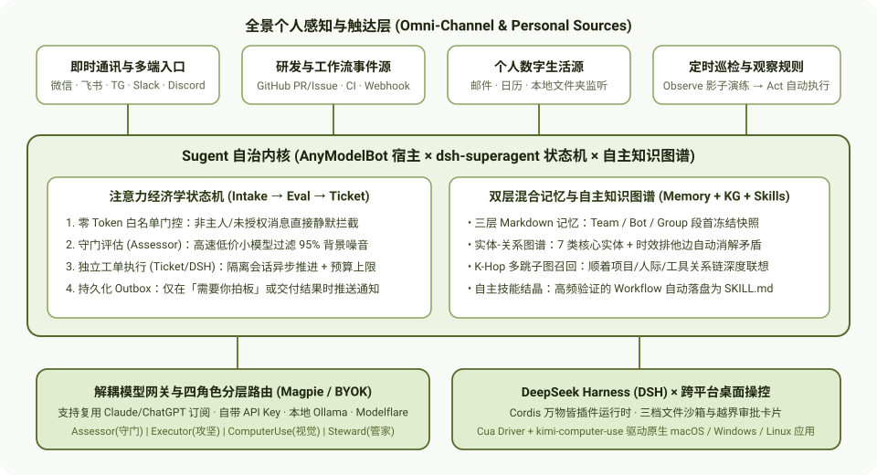
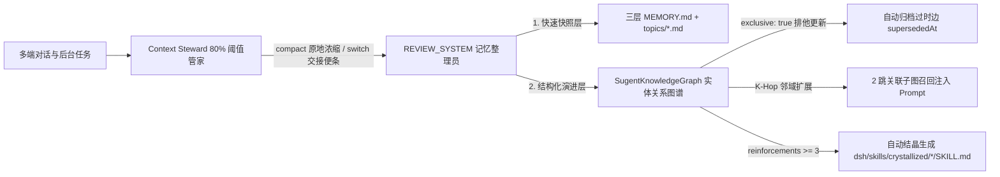
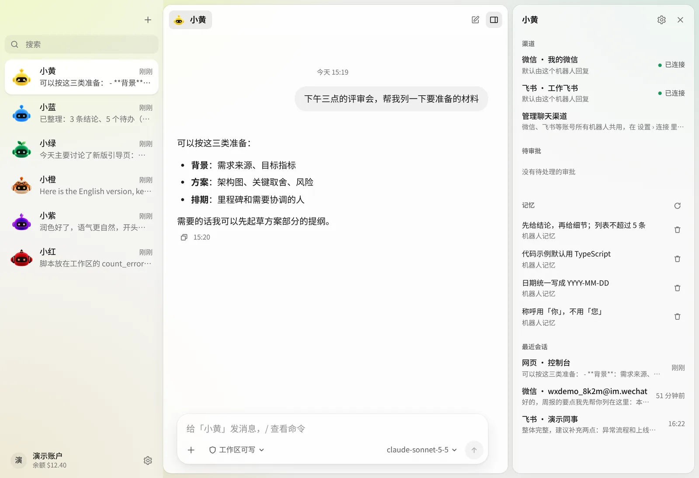
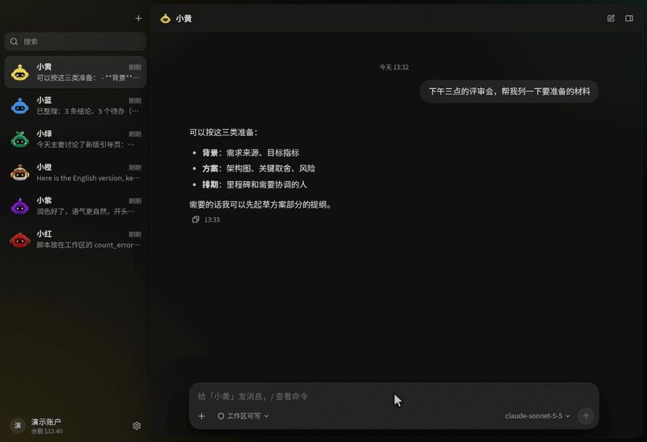
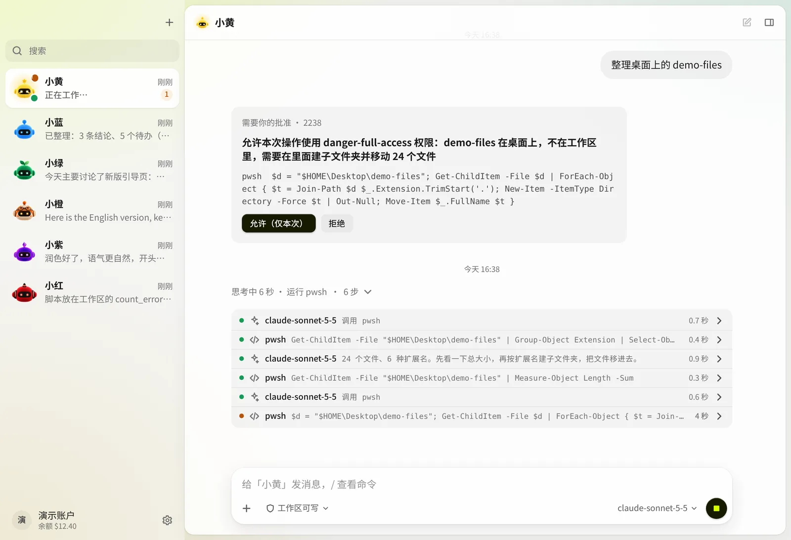
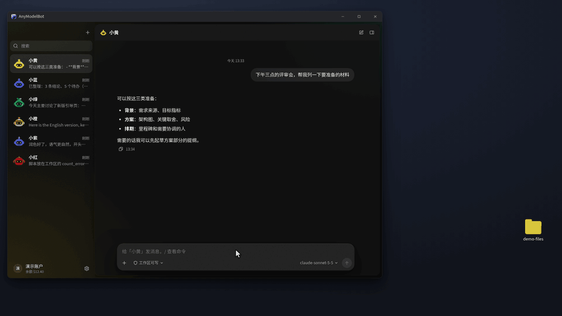
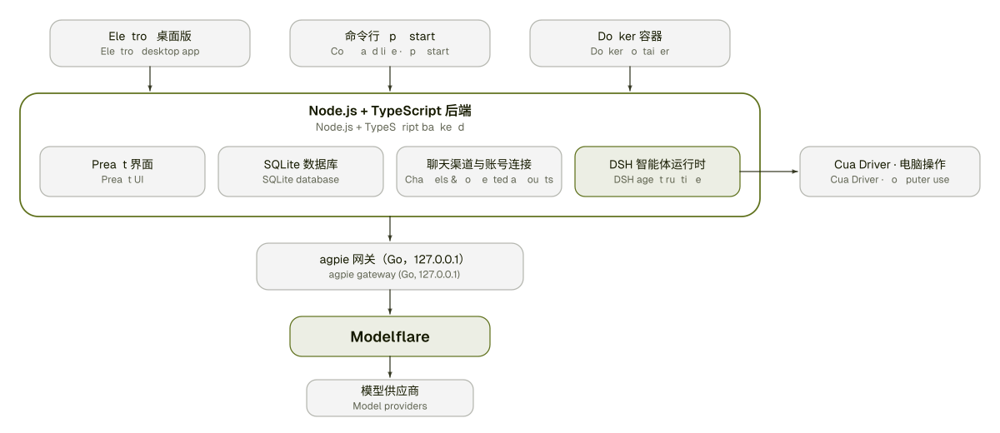

<p align="center">
  <a href="https://github.com/ldc861117/sugent">
    
  </a>
</p>

<h1 align="center">Sugent (Super-Agent)</h1>

<p align="center">
  <b>面向「一人公司」与个人数字主权的全能自治智能体工作台</b><br>
  <sub>融合 <a href="https://github.com/modelflare-ai/AnyModelBot">AnyModelBot</a> 多端触达基建 × <a href="https://github.com/deepseek-ai/dsh-superagent-prototype">dsh-superagent</a> 注意力状态机 × 自主维护知识图谱与技能结晶引擎</sub>
</p>

<p align="center">
  <a href="./ARCHITECTURE.md">架构蓝图</a> ·
  <a href="./docs/ROADMAP.md">中短期演进蓝图</a> ·
  <a href="./docs/plans/2026-11-01-sugent-foundation.md">实施计划</a> ·
  <a href="./AGENTS.md">Agent 研发规范</a> ·
  <a href="./docs/development.md">开发指南</a> ·
  <a href="./README_en.md">English</a>
</p>

<div align="center">


-d7ff00?style=flat-square&labelColor=161a00)


</div>

<p align="center">
  
</p>

# 🌟 为什么构建 Sugent？

2026 年，个人与工程智能体分化出了两条极具代表性的技术路线：
1. **[modelflare-ai/AnyModelBot](https://github.com/modelflare-ai/AnyModelBot)**：拥有极佳的本地桌面端（Electron）、全渠道即时通讯触达（微信、飞书、Telegram、Slack、Discord）、三层 Markdown 记忆与跨平台电脑 GUI 操控（[Cua Driver](https://github.com/trycua/cua)），但默认与单一中转站强绑定，且后台任务状态机较为扁平。
2. **[deepseek-ai/dsh-superagent-prototype](https://github.com/deepseek-ai/dsh-superagent-prototype)**：提出了惊艳的**注意力经济学（Attention Economy）**与严谨的 `Intake → Eval → Ticket → Assignment` 领域状态机，但仅作为一个面向单一 GitHub 仓库的研究原型，缺乏个人多渠道入口与跨会话长期知识体系。

**Sugent（Super-Agent）** 将两者的核心基因在 [DeepSeek Harness (DSH)](https://github.com/deepseek-ai/deepseek-harness) 与开源网关 [yetone/magpie](https://github.com/yetone/magpie) 之上做了深度融合，并补齐了**“算力网关彻底解耦 + 双层混合记忆与自主演进知识图谱 + 经验自动结晶为 `SKILL.md`”**三大核心护城河：

> *"Take as little human attention as possible, and give as much value as possible."*
> —— 平时静默替你过滤 95% 的噪音、在后台独立工作树干活；只在需要你拍板、越界审批或交付最终成果时，向你的微信/飞书发一张简洁卡片。

# 🏛️ 全景融合架构图

<picture>
  <source media="(prefers-color-scheme: dark)" srcset="docs/assets/diagrams/sugent-fusion-dark.svg">
  
</picture>

## 核心技术优势对比

| 核心维度 | [AnyModelBot](https://github.com/modelflare-ai/AnyModelBot) | [dsh-superagent-prototype](https://github.com/deepseek-ai/dsh-superagent-prototype) | **Sugent (本项目)** |
| :--- | :--- | :--- | :--- |
| **定位与形态** | 个人跨渠道 AI 助手（绑定单一中转站） | 单一 GitHub 仓库研发自治原型 | **全能个人数字分身 + 自举式一人公司自治工作台** |
| **模型与算力自由度** | 界面锁定 Modelflare 登录与计费 | 依赖底层 DSH 单一模型配置 | **零代码解耦**：支持复用本机 Claude/ChatGPT 包月订阅、BYOK 自带密钥、本地 Ollama 及四角色分层路由 |
| **任务与事件编排** | 单机器人后台任务 + 定时规则 | `Intake → Eval → Ticket` 严谨状态机 | **全景个人事件源（IM/GitHub/定时/文件）+ 观察满 3 次自动提议转正（Observe-to-Act）** |
| **记忆与知识体系** | 三层扁平 Markdown 列表（仅字面关键词搜索） | 仅 SQLite 工单表，无跨会话知识库 | **三层 Markdown 快照 + 实体关系知识图谱（K-Hop 多跳召回 + 时效排他边消解矛盾）** |
| **能力自生长机制** | 内置固定工具，只记流水账不长技能 | 静态 `skills/` 目录 | **自主技能结晶（Skill Crystallization）**：高频复用的 `workflow` 节点自动落盘生成 `SKILL.md` |

# 🧠 双层混合记忆与自主维护知识图谱

普通智能体“聊完即忘”或只会把对话存成一团互相矛盾的扁平文本。Sugent 在 [`src/agent/memory.ts`](./src/agent/memory.ts) 与 [`src/sugent/knowledge-graph.ts`](./src/sugent/knowledge-graph.ts) 中构建了**双层混合认知引擎**：



1. **第一层：Prompt Cache 友好的三层冻结快照（`team` / `bot` / `group`）**
   每段对话开启时一次性注入 `MEMORY.md` 冻结前缀，既保证跨会话连续性，又不破坏大模型的提示词缓存命中率；内置正则防火墙自动拦截 API Key、密码与身份证号。
2. **第二层：自主维护的实体-关系知识图谱（`SugentKnowledgeGraph`）**
   每次后台记忆归档（`AgentManager.review()`）自动将新知识同步入图（`<dataDir>/knowledge-graph/knowledge-graph.json`）：
   - **7 类标准实体**：`person`、`project`、`repo`、`preference`、`workflow`、`tool`、`concept`。
   - **时效排他边（Temporal Conflict Resolution）**：当你更新某项目的默认模型或服务器配置时，`exclusive: true` 关系会自动将旧边标记为 `supersededAt`，彻底杜绝新旧记忆打架。
   - **K-Hop 多跳联想召回**：提问时顺着关系链向外扩展 2 跳，把项目关联的负责人、工具链与历史排障经验一并召回。
3. **第三层：从“记忆”到“能力”的自主技能结晶（Skill Crystallization）**
   当图谱中的某个 `workflow`（操作流程）节点在实践中累计成功验证达到 **3 次**，引擎会自动将其操作步骤渲染为带 YAML Frontmatter 的标准 `SKILL.md` 并落盘至 `<dataDir>/dsh/skills/crystallized/`，让智能体真正实现“越用越会干活”。

<picture>
  <source media="(prefers-color-scheme: dark)" srcset="docs/assets/screenshots/memory-dark.webp">
  
</picture>

# 🌐 解耦模型网关与四角色分层路由

Sugent 在 [`src/sugent/gateway.ts`](./src/sugent/gateway.ts) 中解开了上游对单一中转站的限制，把选择权完全交还给你：

| 角色 (`ModelRole`) | 环境变量 | 职责说明 | 推荐模型配置 |
| :--- | :--- | :--- | :--- |
| **`assessor`（守门员）** | `SUGENT_MODEL_ASSESSOR` | 常驻处理 `Intake → Eval` 噪音过滤、规则匹配与意图分类 | `deepseek/deepseek-chat` / 本地轻量模型 |
| **`executor`（执行器）** | `SUGENT_MODEL_EXECUTOR` | 负责已立项 `Ticket` 的深度代码编写、架构推理与复杂工具调用 | `anthropic/claude-sonnet-4-5` / `claude-opus-4-6` |
| **`computer_use`（桌面视觉）** | `SUGENT_MODEL_COMPUTER_USE` | 驱动 [Cua Driver](https://github.com/trycua/cua) 与 `kimi-computer-use` 操作原生桌面 GUI | `anthropic/claude-sonnet-4-5` / `openai/gpt-5.4` |
| **`steward`（记忆管家）** | `SUGENT_MODEL_STEWARD` | 负责 80% 窗口压缩判定、交接便条撰写与知识图谱结构化抽取 | `deepseek/deepseek-chat` / `gemini-2.5-flash` |

<picture>
  <source media="(prefers-color-scheme: dark)" srcset="docs/assets/screenshots/models-dark.webp">
  
</picture>

# ⚡ 核心场景图文展示

## 1. 沙箱文件操作与越界审批卡片

机器人拥有独立工作区与三档权限（*只读* / *工作区可写* / *完全权限*）。任何越出工作区的写操作或高风险命令都会自动挂起，向你的桌面端或手机微信/飞书发送一张审批卡片，等你点头后再继续。

<p align="center">
  
</p>

<picture>
  <source media="(prefers-color-scheme: dark)" srcset="docs/assets/screenshots/agent-dark.webp">
  
</picture>

## 2. 跨平台原生桌面操控 (Computer Use) 与多模态生成

内置 [Cua Driver](https://github.com/trycua/cua) 与 [kimi-computer-use](https://github.com/songkeys/kimi-computer-use) 桥接，可直接读取窗口无障碍树、点击按钮、填写表单、操作本地软件，并支持按预算阈值管控图片与视频生成。

<p align="center">
  
</p>

<p align="center">
  
</p>

## 3. 微信 / 飞书 / Telegram / Slack / Discord 随身触达

扫码即可绑定个人微信（基于 [openclaw-weixin](https://github.com/Tencent/openclaw-weixin)），或填入 Token 接入飞书流式卡片、Telegram、Slack、Discord。在手机微信里引用机器人的汇报消息即可直接追问对应后台工单（`attach_ticket`）。

<p align="center">
  
</p>

<picture>
  <source media="(prefers-color-scheme: dark)" srcset="docs/assets/screenshots/chat-dark.webp">
  
</picture>

# 📥 下载

你可以通过源码直接构建运行，或在 Releases 页面获取对应平台（macOS Apple Silicon / Intel、Windows x64 / arm64、Linux AppImage 及 Docker）的安装包。

<p align="center">
  
</p>

# 🚀 快速开始与双上游同步

## 1. 克隆并验证核心架构

```bash
git clone https://github.com/ldc861117/sugent.git
cd sugent
npm install --ignore-scripts

# 运行 Sugent 全套类型检查、构建、知识图谱契约测试与文档自检
npm run verify:sugent
```

## 2. 配置免 Modelflare 网关 / 解锁本机订阅（可选）

复制 [`.env.example`](./.env.example) 为 `.env`，按你的偏好选择算力接入方式：

```bash
# 方式 A：接入本地运行的原版 magpie 网关或任意 OpenAI 兼容端点（LiteLLM / OneAPI / Ollama）
export SUGENT_GATEWAY_MODE=external
export SUGENT_GATEWAY_URL=http://127.0.0.1:3425/v1
export SUGENT_GATEWAY_KEY=magpie

# 方式 B：解锁内置网关对本机 Claude Code / ChatGPT / Copilot 订阅账号的自动发现与本地隐私脱敏
export SUGENT_UNLOCK_SUBSCRIPTIONS=1
export SUGENT_PRIVACY_MASKING=1

# 开启后台归档时的深度知识图谱三元组与 SOP 工作流抽取
export SUGENT_KG_DEEP_EXTRACT=1
```

## 3. 与双上游仓库保持无冲突同步

Sugent 采用**三层零侵入目录拓扑**（详情见 [`ARCHITECTURE.md`](./ARCHITECTURE.md)）：根目录追踪 `AnyModelBot`（`upstream-amb`），[`packages/dsh-superagent`](./packages/dsh-superagent) 通过 `git subtree` 追踪 `dsh-superagent-prototype`（`upstream-dsh`），所有自研核心代码隔离在 [`src/sugent/`](./src/sugent)。

```bash
# 只读检查两个上游仓库的最新 Commit
npm run sync:upstreams

# 一键拉取并合并 AnyModelBot 主干 + dsh-superagent 子树
npm run sync:upstreams:merge
```

<picture>
  <source media="(prefers-color-scheme: dark)" srcset="docs/assets/diagrams/architecture-dark.svg">
  
</picture>

# 🗺️ 中短期演进蓝图 (Roadmap)

完整规划见 [`docs/ROADMAP.md`](./docs/ROADMAP.md)，核心推进节奏如下：

### 阶段一：短期蓝图（第 1–4 周）—— 算力解耦、知识图谱闭环与自举维护
- [x] **M1.1 仓库基座与双上游 Subtree 拓扑搭建**：完成 `AnyModelBot` 宿主与 `dsh-superagent` 状态机同仓融合及一键同步脚本（[`scripts/sync-upstreams.mjs`](./scripts/sync-upstreams.mjs)）。
- [x] **M1.2 网关解耦与四角色分层路由**：落地 [`src/sugent/gateway.ts`](./src/sugent/gateway.ts) 与 `SUGENT_UNLOCK_SUBSCRIPTIONS` 订阅解锁。
- [x] **M1.3 自主维护知识图谱与技能结晶引擎**：落地 [`src/sugent/knowledge-graph.ts`](./src/sugent/knowledge-graph.ts)，接入 `AgentManager.review()` 自动沉淀节点、消解排他边矛盾并将高频 `workflow` 落盘为 `SKILL.md`。
- [ ] **M1.4 自举式仓库维护官（Dogfooding）**：配置第一条主动规则，让 Sugent 每日自动巡检双上游更新、跑单测并向你的微信/飞书推送合并审批卡片。

### 阶段二：中期蓝图（第 1–3 个月）—— 全景个人事件总线与影子学习工作台
- [ ] **M2.1 个人邮件、日历与本地文件夹监听源**：扩展 [`PersonalSourceRegistry`](./src/sugent/sources.ts)，支持 Gmail/IMAP、日历提醒与 `~/Downloads` 文件自动分诊归档。
- [ ] **M2.2 影子演练账本（Shadow Ledger）与一键转正 UI**：在本地控制台可视化展示 `observe` 模式下智能体“本打算做什么（`would`）”，满 3 次无误后一键升级为 `act` 自动执行。
- [ ] **M2.3 知识图谱可视化面板与多端加密同步**：在前端信息面板增加交互式实体关系图谱视图，并支持通过 Git/WebDAV/S3 跨设备加密同步记忆与结晶技能库。

### 阶段三：长期与商业化蓝图（第 3–6 个月）—— 一人公司生态与数字员工交付
- [ ] **M3.1 Open-Core 旗舰安装包与移动端伴侣面板**：提供免配置的跨平台签名安装包与手机端专属「需要你（Needs You）」拍板伴侣。
- [ ] **M3.2 垂直场景自治规则与结晶技能包（Playbooks）市场**：沉淀并分发面向独立开发者、跨境电商、外贸分诊与个人财务的开箱即用规则与技能包。
- [ ] **M3.3 小微团队 Turnkey 私有化数字员工镜像**：推出带群聊静默旁听（`followForContext`）与团队预算硬上限的 NAS / 私有云一键部署套件。

# 📜 许可证与致谢

本项目以 [MIT 许可证](./LICENSE) 发布。核心架构站在以下优秀开源项目的肩膀之上：
- [modelflare-ai/AnyModelBot](https://github.com/modelflare-ai/AnyModelBot)（MIT）
- [deepseek-ai/dsh-superagent-prototype](https://github.com/deepseek-ai/dsh-superagent-prototype)（MIT）
- [deepseek-ai/deepseek-harness](https://github.com/deepseek-ai/deepseek-harness)（MIT）
- [yetone/magpie](https://github.com/yetone/magpie)（MIT）
- [Fei2411/DS-Bot](https://github.com/Fei2411/DS-Bot)（Apache-2.0）
- [trycua/cua](https://github.com/trycua/cua) & [songkeys/kimi-computer-use](https://github.com/songkeys/kimi-computer-use)（MIT）
- [Tencent/openclaw-weixin](https://github.com/Tencent/openclaw-weixin)（MIT）

完整的第三方组件许可证声明见 [THIRD_PARTY_NOTICES.md](./THIRD_PARTY_NOTICES.md)。
