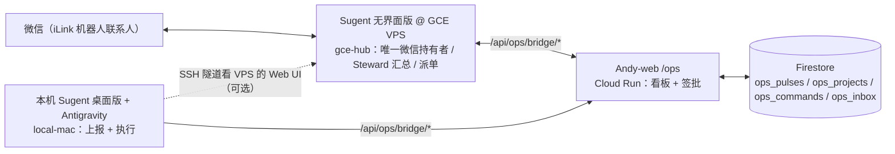

# GCE 常驻中枢：Sugent 云端部署 × 微信 × `/ops` 看板统一方案

> **状态**：待确认（2026-11-24）
> **关联**：Andy-web `/ops` 蓝图（conv `266a391e`）、[P1 微信 Concierge](./2026-11-12-p1-opc-wechat-concierge.md)、[P0 Auth Broker](./2026-11-12-p0-sugent-auth-broker.md)

## 0. 商业策略自省四问（AGENTS.md §3.3 门禁）

1. **付费锚点**：本方案属于「个人自用基座 + 未来商业版的参考部署形态」。它把「本地主权 + 7×24 常驻代理 + 微信移动审批」串成闭环，正是 Sugent 相对大厂全家桶的差异点（跨生态中立、数据在自己的机器与 GCP 项目里）。未来可抽象为「自托管常驻节点」付费引导，但本期不做商业包装。
2. **合规与分发**：不改桌面安装包、不内置任何密钥；VPS 侧密钥全部走环境变量 / Secret Manager。微信走腾讯官方开源的 iLink 机器人协议（openclaw-weixin，MIT），非网页逆向。风险点：一个机器人身份只允许一个持有进程，已在设计中约束。
3. **离线退路**：本机桌面版 `mode: "none"` + BYOK 完全不依赖 VPS 与 Firestore；VPS 宕机时仅失去「微信入口」与「云端汇总」，本地对话、巡检、预算账本照常。
4. **一人公司运维杠杆**：VPS 只跑一个 Docker 容器（`restart=always`），不开公网端口（SSH 隧道访问 UI）；看板仍是 Cloud Run 缩容归零；状态全部在 Firestore，容器可随时重建。日常运维趋近于零。

## 1. 结论与目标

**一个大脑、一份数据、三个入口：**

| 角色 | 节点 | 职责 | 不做 |
|---|---|---|---|
| 大脑 | `gce-hub`（GCE VPS 上的 Sugent 容器） | 独占微信机器人；Steward 读全局快照、整理阶段目标、生成派单与提醒 | 不直接读 Mac 本地文件 |
| 数据 | Firestore（经 Andy-web `/api/ops` 读写） | 唯一真相源：项目、进度脉冲、指令、签批 | — |
| 看板 | Andy-web `/ops`（Cloud Run） | 全局查看、Tier 拨档、签批 | 不常驻、不跑代理 |
| 本机 | `local-mac`（Sugent 桌面版 + Antigravity） | 按 Tier 上报本地仓库进度；领取并执行派给本机的指令 | **不开微信通道** |

## 2. 现状实证（2026-11-24 盘点）

- Sugent：无任何云端部署。[Dockerfile](../../Dockerfile) 已支持无界面运行（`AMB_DATA_DIR=/data`、UI 端口 `AMB_UI_PORT=3600`、`AMB_UI_TOKEN`）；CI 的 `docker.yml` 发布的是上游 `modelflare-ai` 镜像，**不含 Sugent 改动**，需自建镜像。
- 微信：[weixin/api.ts](../../src/channels/weixin/api.ts) 为 `ilink/bot/getupdates` 长轮询，必须常驻进程，且单机器人凭证只能一处消费。
- Andy-web：服务端已有 `/api/ops/node/auth`（节点令牌 → 1h JWT）、`/bridge/pulse|sync|commands|steward-pending|steward-sync` 等接口，`firestore.rules` 已按节点隔离；**但 Sugent 侧尚无任何代码调用这些接口**（全仓 grep 为零），且 Andy-web 的 `/ops` 改动大量未提交、Firestore 模式（`OPS_STORAGE_MODE=firestore`）未在线上开启。
- Steward：[steward-host-service.ts](../../src/sugent/steward-host-service.ts) 目前直接读本机 `~/.gemini/config/projects`、`sidecars` 等目录——这是看板与实际进度对不上的结构性原因之一：它只看得到本机。

## 3. 分阶段实施

### 阶段 A：`/ops` 先上线（Andy-web 仓，依赖 conv `266a391e` 的未提交改动）

1. 收口并提交 Andy-web 当前 `/ops` 改动（需先与该会话的进行中工作对齐，避免互相覆盖）。
2. Cloud Run 开启 `OPS_STORAGE_MODE=firestore`；在 Secret Manager 创建 `OPS_NODE_TOKEN_LOCAL_MAC`、`OPS_NODE_TOKEN_GCE_HUB` 并挂载。
3. 部署 `firestore.rules`。
- **验收**：`curl -X POST /api/ops/node/auth` 用两个节点令牌各换到 JWT；`/ops` 登录后能看到空舰队。

### 阶段 B：GCE VPS 部署 Sugent 无界面版

1. **体检**：确认 VPS 规格（建议 ≥ 2 vCPU / 4 GB，DSH + magpie 常驻约 1–2 GB）、Docker 是否已装、到 `ilinkai.weixin.qq.com` 与各 BYOK 模型端点的连通性（`curl --max-time 10`）。
2. **镜像**：新增 `.github/workflows/sugent-image.yml`（或在 VPS 上 `docker build`），产出 `ghcr.io/ldc861117/sugent:<sha>`，与上游 `docker.yml` 并存，不改上游文件。
3. **运行**：`deploy/gce-hub/compose.yml`（新目录）：
   - `restart: always`，卷 `sugent-data:/data`；
   - `AMB_UI_HOST=127.0.0.1`，**不开公网端口**，UI 通过 `ssh -L 3600:127.0.0.1:3600` 访问；
   - BYOK 密钥、`OPS_NODE_TOKEN`、`OPS_BASE_URL` 走 `.env`（`chmod 600`，不入库）；
   - 节点身份 `SUGENT_NODE_ID=gce-hub`。
4. **备份**：`/data` 每日快照（GCE 磁盘快照策略，保留 7 天）。
- **验收**：容器重启后 UI 可经隧道打开；Web 对话使用 BYOK 模型正常回复。

### 阶段 C：微信迁移到 VPS

1. 本机桌面版：设置里移除/停用微信通道（`botToken` 失效前不要两边同时在线）。
2. VPS：经隧道打开 UI → 微信扫码绑定 → 用手机给机器人发一句话验证往返。
3. 增加**单持有者守卫**：Sugent 启动时若检测到 `SUGENT_NODE_ID !== SUGENT_WEIXIN_OWNER_NODE`（默认 `gce-hub`），微信通道只读不启动并在 UI 提示，防止误在 Mac 上重新开启。
- **验收**：Mac 合盖 30 分钟后，手机发消息仍在 10 秒内得到回复。

### 阶段 D：舰队桥接客户端（Sugent 核心新增，零侵入）

新增 `src/sugent/ops-bridge-client.ts`（纯 `fetch`，可注入 `fetchImpl` 便于测试）：

| 方法 | 对接接口 | 谁调用 |
|---|---|---|
| `authenticate()` | `POST /api/ops/node/auth` → 缓存 1h JWT，提前 5 分钟续期 | 所有节点 |
| `pushPulse(projects)` | `POST /bridge/pulse`（按 Tier 裁剪：Tier0 只发代号/时间/计数） | `local-mac`、`gce-hub` |
| `pushSync(docs)` | `POST /bridge/sync`（仅 Tier2 治理文档摘要） | `local-mac` |
| `pullCommands()` / `ack()` | `GET /bridge/commands`、`POST /bridge/commands/:id/ack` | 各节点领取派给自己的指令 |
| `stewardPending()` / `stewardSync()` | `GET /bridge/steward-pending`、`POST /bridge/steward-sync` | 仅 `gce-hub` |

- 挂接点：复用 `app.ts` 已有的 `stewardPulseTimer`（[app.ts](../../src/app.ts) 约 1162 行）节拍，新增可选回调，**未配置 `OPS_BASE_URL` 时完全不启用**（守住 `mode: "none"`）。
- Steward 双模：`local-mac` 继续读本地目录并上报；`gce-hub` 改为从 `stewardPending()` 读全局快照，由它统一产出「阶段目标 / 本周重点 / 待签批」写回 `stewardSync()`。
- **验收**：本机上报后 1 分钟内 `/ops` 出现 `local-mac` 脉冲；`gce-hub` 整理结果出现在看板。

### 阶段 E：微信 ↔ 看板闭环

复用 [owner-channel-steward-router.ts](../../src/sugent/owner-channel-steward-router.ts)，只对 `isOwnerPeer=true` 的私聊生效：

| 你在微信说 | gce-hub 做什么 | 落到哪里 |
|---|---|---|
| 「airtoken 现在到哪了？」 | 读全局快照，用大白话回复阶段/阻塞/下一步 | 仅回复 |
| 「sugent 下周重点排一下」 | 生成排期草案 → 待签批 | `ops_inbox`，微信回一张确认卡 |
| 「同意」/「/ok <id>」 | 签批通过 → 生成指令 | `ops_commands`（`targetNodeId`） |
| 早间 / 有新待签批 | 主动推送摘要（复用 `proactive-cadence`、同内容 1 分钟去重） | 微信 |

- 群聊一律静默（沿用 P1 Concierge G2 规则）；涉及资金、合同、对外发言的指令强制走看板二次确认。
- **验收**：微信发起一条排期 → `/ops` 出现待签批 → 微信回「同意」→ 目标节点领到指令并 ack。

## 4. 文件变更清单

| 仓库 | 文件 | 类型 |
|---|---|---|
| sugent | `src/sugent/ops-bridge-client.ts` | 新增 |
| sugent | `src/sugent/steward-host-service.ts` | 小改：增加「远端快照」数据源分支 |
| sugent | `src/app.ts` | 小改：节拍挂接桥接客户端、微信单持有者守卫（薄适配） |
| sugent | `deploy/gce-hub/compose.yml`、`.env.example`、`README.md` | 新增 |
| sugent | `.github/workflows/sugent-image.yml` | 新增 |
| sugent | `test/sugent-ops-bridge-client.unit.test.ts`、`test/sugent-weixin-owner-guard.unit.test.ts` | 新增 |
| Andy-web | 收口 `/ops` 改动、Cloud Run 环境变量与密钥 | 变更（阶段 A） |

不触碰 `src/channels/`、`src/tasks/service.ts`、`packages/dsh-superagent/` 内部实现。

## 5. 验证门禁

- 每阶段代码改动：`npm run typecheck`、`npm run test:sugent`、`npm run verify:sugent` 全绿。
- 桥接客户端单测覆盖：JWT 续期、401 重新认证、Tier0/1/2 字段裁剪、未配置时零请求、指令 ack 幂等。
- 线上冒烟：阶段 A–E 各自的「验收」条目逐条执行并记录到 `walkthrough`。

## 6. 风险与对策

| 风险 | 对策 |
|---|---|
| GCE（`us-central1`，美国出口）到 iLink 连通性或风控 | 阶段 B 第 1 步先测；不通则改用国内轻量云节点仅跑微信通道 |
| 两处同时持有微信凭证导致抢消息 | 阶段 C 单持有者守卫 + 迁移顺序（先停 Mac 再扫 VPS） |
| VPS 失守泄露项目正文 | `gce-hub` 节点令牌 `max_tier_cap` 可设上限；`ops_artifacts` 节点只写不读（已有 rules） |
| Andy-web 未提交改动与另一会话冲突 | 阶段 A 先对齐再提交，必要时由该会话收口 |
| VPS 内存不足 | 阶段 B 体检；不足则升配或关闭 magpie 托管改用外部网关 |

## 7. 需要用户执行/确认的动作

- [x] VPS 已确认：`airtoken-micro`（`us-central1-a`，`e2-medium` 2 vCPU / 4 GB，RUNNING），本机 `gcloud` 可用。**注意它同时承载 airtoken 的 Antigravity 远程开发**，阶段 B 需先看内存余量，并给 Sugent 容器设 `mem_limit: 1.5g`；若长期吃紧，再考虑升到 `e2-standard-2`（8 GB）。
- [ ] 阶段 B 部署、阶段 C 微信扫码（扫码需你本人手机）。
- [ ] 阶段 A 中 Cloud Run 环境变量与 Secret 的写入授权。
