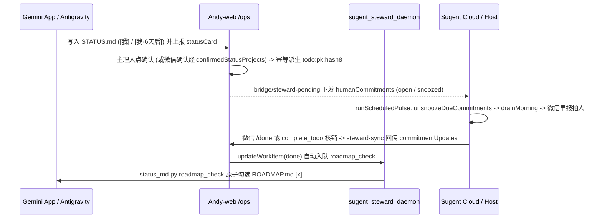

# 人机混合项目规划与现实待办全闭环方案（Wave P4 · Hybrid Project Planning & Commitment Bridge）

> 关联主干：`docs/ROADMAP.md` · `AGENTS.md` · `src/sugent/stewardship-ledger.ts` · `src/sugent/ops-bridge-client.ts`

## 0. 商业策略自省四问（AGENTS.md §3.3 强制门禁）

| 自省维度 | 核心拷问 | 本方案的守线决策 |
| :--- | :--- | :--- |
| **1. 付费锚点（Why Pay & Moat）** | 属于开源引流基座还是商业付费增值？相比竞品优势在哪？ | **开源基座**：五维账本 `CommitmentItem`、动作语义解析与 `snoozed` 到期自动唤醒引擎 100% 开源透明。**商业增值**：云端 `gce-hub` 在微信端的主动早报拍人、自然语言 `/done` 销账与跨端状态拉平，把代码仓迭代与现实交付彻底贯通，而非只服务程序员终端。 |
| **2. 合规与分发（Distribution & ToS Risk）** | 能否通过 macOS 公证/Windows 签名与企业审计？有无封号风险？ | 纯本地 Markdown/JSON 契约与标准 HTTP 桥接同步，零非官方协议二进制，主号微信仍严守官方 `iLink` 边界，零额外封号与分发合规风险。 |
| **3. 离线退路（Sovereignty Fallback）** | 剥离云端账号进入 `mode: "none"` 后，核心闭环是否完整自洽？ | 离线单机模式下，本地 `STATUS.md`、`ROADMAP.md` 与 `StewardshipLedger` 100% 独立运行，`unsnoozeDueCommitments` 与 `/done` 在单机照常闭环。 |
| **4. 一人公司运维杠杆（OPC Ops Leverage）** | 是否符合“无状态边缘服务 + 端侧重逻辑”？ | 零新增后台常驻进程，直接复用既有 `ops-bridge-client`、`sugent_steward_daemon.mjs` 与 `ProactiveCadence` 脉搏，单人运维成本趋近于零。 |

## 一、四层闭环契约设计

1. **SOP 语法层（`STATUS.md` / `ROADMAP.md`）**：
   - 行内前缀：`[AI]`（Agent 交付）、`[我]`（本人亲办，`i_owe`）、`[我·Nd后|N周后|YYYY-MM-DD]`（延时亲办，一次性折算精确日期）、`[等外部]`（`waiting_for`）、`[观察窗·N天|YYYY-MM-DD]`（`expiring`）。
   - 铁律：Coding Agent 严禁擅自勾 `[x]` 标记为 `[我]`/`[等外部]`/`[观察窗]` 的路线图条目。
2. **`/ops` 看板层**：
   - 确认 `STATUS.md` 时预览并勾选现实候选，以 `todo:<projectKey>:<fnv1a8>` 幂等派生 `OpsWorkItem`。
   - 未到 `snoozeUntil` 的事项收在「⏳ 等待窗口」，到期当天自动浮回「④ 等你拍板」；核销完成时入队 `roadmap_check` 回写路线图。
3. **Sugent 主脑与桥接层**：
   - `OpsBridgeClient` 拉取 `humanCommitments`，`SugentStewardHostService.syncOpsHumanCommitments` 按 `updatedAt` LWW 幂等写入 `CommitmentItem`。
   - `runScheduledPulse` 先调用 `unsnoozeDueCommitments` 解冻到期项，再进入 `drainMorning` 早报与微信提醒；支持 `/done <id|P3.x|关键词>` 双端销账回传 `commitmentUpdates`。

## 二、第 29 节门禁验收清单

- 远程 `humanCommitments` 幂等落账，`snoozeUntil > today` 置为 `snoozed`；
- 到期当天 `runScheduledPulse` 自动解冻为 `open` 并进入 `morningDrain.emitNow`；
- 微信端 `/done P3.5` 销账后，本地状态转为 `closed` 并生成 `commitmentUpdates` 同步 `/ops` 与 `nextAiHint` 提示。

## 三、端到端状态流转时序与字段映射

### 字段级契约映射

| 层级 | 状态卡前缀 | `/ops` `OpsWorkItem` 字段 | Sugent `CommitmentItem` 字段 |
| :--- | :--- | :--- | :--- |
| 本人即办 | `[我]` | `stage: "needs_you"`, `actor: "human"` | `status: "open"`, `direction: "i_owe"` |
| 延时亲办 | `[我·N天后\|YYYY-MM-DD]` | `stage: "running"`, `snoozeUntil: "YYYY-MM-DD"` | `status: "snoozed"`, `dueAt: "YYYY-MM-DD"` |
| 等外部 | `[等外部]` | `stage: "needs_you\|running"`, `actor: "external"` | `direction: "waiting_for"` |
| 观察窗 | `[观察窗·N天\|YYYY-MM-DD]` | `stage: "running"`, `snoozeUntil: "YYYY-MM-DD"` | `status: "snoozed"`, `direction: "expiring"` |

## 四、本方案涉及核心文件清单

- `src/sugent/ops-bridge-client.ts`、`src/sugent/steward-host-service.ts`、`src/sugent/steward-llm-agent.ts`
- `src/sugent/owner-channel-steward-router.ts`、`src/sugent/edge-tentacle-hub.ts`、`src/app.ts`
- `test/sugent-hybrid-project-commitments.unit.test.ts`、`scripts/verify-sugent.mjs`（第 29 节）
- `docs/ROADMAP.md`（Wave P3 新增 `P3.5`、`P3.6` 现实关口）与 `docs/decisions/steward-notes.md`
