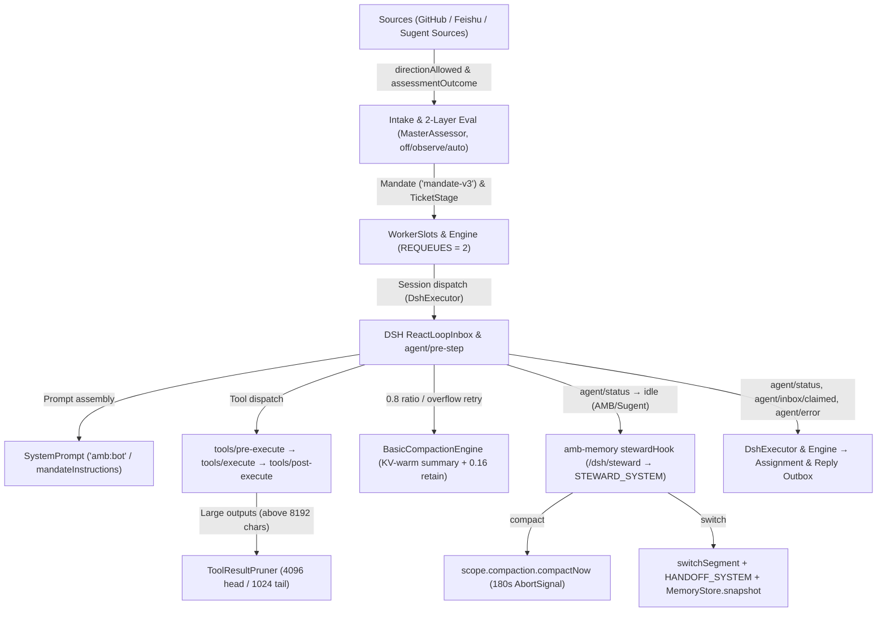
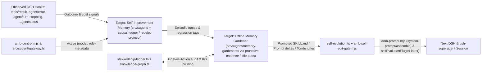

# DeepSeek Harness (DSH) & `dsh-superagent-prototype`: Autonomy, Zero-Intrusion Extension & Evolutionary Ceiling Analysis

> **Scope**: Primary-source audit of local `deepseek-harness` runtime (`@deepseek-ai/dsh@0.2.1-rc.4` in `dsh-runtime/`), `packages/dsh-superagent/` (`deepseek-ai/dsh-superagent-prototype` subtree), `dsh-runtime/plugins/`, `src/agent/{host.ts,manager.ts,steward.ts,memory.ts}`, and `src/sugent/`, triangulated with public DeepSeek Harness and `dsh-superagent-prototype` documentation.

## Executive Summary

DeepSeek Harness (**DSH**) and `dsh-superagent-prototype` provide Sugent with two complementary foundations:

1. **A hot-composable Cordis microkernel (`deepseek-harness`)** where the agent loop, tool execution pipeline, prompt assembly, compaction, subagents, permissions, and Git worktrees communicate exclusively through typed services, reversible `ctx.effect()` scopes, and `waterfall` / `serial` / `emit` hooks.
2. **An Attention-Economics transactional coordinator (`dsh-superagent`)** built around *"Take as little human attention as possible, and give as much value as possible"* ([`000-philosophy.md`](../../packages/dsh-superagent/docs/000-philosophy.md#L5)), separating a noisy-event **Gate + Assessment** router (`Intake -> Eval`) from isolated **Executor** sessions (`Ticket -> Assignment -> Report -> Reply`).

Sugent extends both layers **zero-intrusively** via Cordis runtime plugins (`dsh-runtime/plugins/*.mjs`), `AgentHost.writePatch()` (`src/agent/host.ts`), and pure TypeScript modules under `src/sugent/`, keeping `packages/dsh-superagent/` unmodified for `npm run sync:upstreams:merge`.

However, **DSH + `dsh-superagent` only solve single-ticket execution and defensive attention gating—not continual self-evolution**. Their transactional SQLite store records outcomes without causal credit assignment, `SKILL.md` crystallization lacks hypotheses or outcome-delta verification, BYOK model switches cause cross-model harness amnesia, and there is no offline Memory Gardener to consolidate cross-session failures, prune stale graph edges, or trigger surgical regression rollbacks.

---

## 1. How `dsh-superagent` Attention Economics & DSH Cordis Hooks Work Together

### 1.1 `dsh-superagent` Attention Economics & Transactional Domain Pipeline

`dsh-superagent` rejects unconstrained chat-session sprawl by treating **human attention as the scarcest resource** ([`000-philosophy.md`](../../packages/dsh-superagent/docs/000-philosophy.md#L3-L33), [`001-domain.md`](../../packages/dsh-superagent/docs/001-domain.md#L5-L38)). Every external event follows a strict transactional path inside `Engine` (`packages/dsh-superagent/src/core/engine.ts#L24-L270`):

1. **Source Filtering & Intake (`Intake.receive`, `src/core/intake.ts#L19-L62`)**:
   - `SourceKind` plugins (`githubKind` in `src/sources/github.ts`, `feishuKind` in `src/sources/feishu.ts`) normalize external events into immutable `Trigger` objects with deterministic SHA-keyed IDs (`key(...)`) and drop bot self-messages before entering the domain.
   - `SourceRegistry.scope()` (`src/sources/registry.ts#L124-L132`) drops out-of-scope triggers as `filtered` (persisted in `disposition` for explainability, creating no `Thread`).
   - If a trigger arrives on a `Thread` already subscribed by a live or resumable `Ticket` (excluding `context`-only subscriptions), `Intake` fans it out as a `TicketInput` (`Tickets.addInput`). Only when `followupOwners(trigger)` (`src/core/model.ts#L75-L88`) is empty does the trigger enter `Eval`.
2. **Two-Layer `Eval` (`Gate` + `MasterAssessor`)**:
   - **Layer 1 — Deterministic Gate (`settingsPolicy().gate` in `src/policy.ts#L191-L211`)**: Evaluates sender membership (`allowedSender`, `listedBot`), `addressed` (`mention` | `direct`), and the 3-cell `AdmissionRow` (`listedUnaddressed`, `unlistedAddressed`, `unlistedUnaddressed` in `src/admission.ts#L8-L13`) to assign strength `explicit`, `inferred`, or reject (`not_a_member`, `admission_ignored`, `no_mention`, `not_human`). Non-human events pass `machineGate` (`src/policy.ts#L171-L188`) only as `inferred` at most.
   - **Layer 2 — Semantic Assessment (`MasterAssessor` in `src/app/assessment.ts#L89-L220`, `assessmentOutcome` in `src/policy.ts#L40-L61`)**: The `dsh-superagent-router` main session evaluates `inferred` candidates against every enabled rule (`rule_assessments`) and `AdmissionDirectionSchema` (`implementation_requested && target_basis !== 'undetermined' && !requires_design_decision`).
   - **`off` -> `observe` -> `auto` (`src/policy.ts#L55-L58,L84`)**: Default mode is **`observe`**, where positive assessments of inferred triggers are converted to `ignore` with `audit.would_accept = true` and `reason: { code: 'observed' }`—producing zero side effects until operators promote to `auto`.
3. **Immutable `Mandate` & Revalidation (`src/policy.ts#L116-L118,L213-L240`)**:
   - Accepted work binds a `Mandate` recording `strength`, `policyVersion` (hashed from rules, `eval.mode`, and per-source policy), `MandateBasis`, `actor`, and `scope`.
   - Prompts and external messages are untrusted data (`docs/004-prompts.md#L65-L71`); only host code creates/revokes Mandates. Ended Tickets retain subscriptions and resume on human follow-ups only if `revalidate(mandate)` still passes under the active policy (`Tickets.wake`, `src/core/tickets.ts#L252-L270`).
4. **Ticket Stage, Assignment & Post-Commit Effects (`src/core/stage.ts`, `src/executor/dsh.ts`, `src/app/effects.ts`, `src/app/outbox.ts`)**:
   - Every `Engine` command runs synchronously inside SQLite `Store.atomic()` (`src/app/store.ts`), enqueuing external side effects (`assessment`, `launch`, `delivery`, `relay`, `notice`, `reply`) into the durable `Effects` table only upon commit.
   - `DshExecutor` (`src/executor/dsh.ts#L207-L673`) binds each Ticket to one isolated session (`worker-<ticketId>`) and one worktree directory (`<stateDir>/work/<name>-<id12>`), governed by `WorkerSlots` (reserving `+1` priority slot for human follow-ups) and 3-attempt transient backoff (`TRANSIENT_TRIES = 3`).
   - Workers surface progress via `orchestrator_report` (`progress | waiting | ready | blocked | failed | dropped`) and single-question `attention` fields; `Outbox` writes idempotent `reply` receipts ordered per Ticket-conversation (`docs/003-execution.md#L179-L191`).

### 1.2 DSH Cordis Microkernel Hooks, Context Compaction, Subagents & Worktrees

DeepSeek Harness (`@deepseek-ai/dsh@0.2.1-rc.4`, [deepseek-ai/deepseek-harness](https://github.com/deepseek-ai/deepseek-harness), docs at [deepseek-harness.github.io/deepseek-harness](https://deepseek-harness.github.io/deepseek-harness/)) structures its agent runtime as composable Cordis services and waterfall/serial/emit hooks inside `dsh-runtime/node_modules/@deepseek-ai/`:

| Subsystem | Compiled Runtime File | Key Exports, Hooks & Verified Limits |
| --- | --- | --- |
| **Agent Registry** | `dsh-agent/lib/types/index.js` | `AgentRegistry` (`ctx.agents`); serial `agent/created` (`#L334`), `agent/disposed` (`#L298`); `AsyncLocalStorage` initiator scope (`runWithInitiator`) and `installTurnArchiveAdmission`. |
| **ReAct Loop & Inbox** | `dsh-agent-loop/lib/index.js` | `ReactLoopInbox` (`next-turn`, `next-step`, emits `agent/inbox/claimed|inserted|discarded` at `#L106`, `#L205-206`); `agent/pre-step` waterfall (`#L909-920`, returns `enter` or `reject`); `agent/turn-stopping` serial (`#L1001`); `agent/request` waterfall (`#L1191-1197`); `agent/request-error` waterfall (`#L1136-1145`, supports `{ kind: "retry" }`); `agent/status` (`#L798`), `agent/error` (`#L880`), `agent/assistant-stream` (`#L1080`). |
| **System Prompt** | `dsh-system-prompt/lib/index.js` | `SystemPrompt` (`ctx.systemPrompt`, `#L213-407`): `SECTION_ORDERS` (`HARNESS_IDENTITY: -1000` through `DEPLOYMENT_PERSONA_SUFFIX: 10200`), `section()`, `context()`, `suppressRuntimeContext()`, `tools()`, `variable()`, `refreshContext()` (`#L324-346`), and waterfall `system-prompt/assemble` (`#L398`; returning `complete: true` replaces other sections `#L401-405`). |
| **Tool Execution Pipeline** | `dsh-tools/lib/index.js` | `prepareExecution` (`#L3310-3370`) runs `tools/pre-execute` waterfall (default `{ kind: "allow" }`, supports `allow`, `ask` via `ctx.get("approval").request(...)`, `deny`, `cancel` + `guardReason(exec)`); `dispatchScheduledExecution` (`#L3423-3446`, `tools/execute` waterfall); `postExecute` (`#L3599-3620`, `tools/post-execute` waterfall returning `accept` or `block` + `additionalContexts`); `notifyResult` (`#L3505-3523`, `tools/result`); `tools/ptc-dispatch-log` (`#L3173`). |
| **Tool Result Pruner** | `dsh-compaction-tool-result-pruner/lib/index.js` | `ToolResultPruner` (`#L61-192`): `DEFAULTS = { thresholdChars: 8192, headChars: 4096, tailChars: 1024 }`; emits `compaction/prune` + rewritten `tool/result` with `surfaceOp: { op: 'replace' }` marked by `PRUNE_MARKER`. |
| **Basic Compaction Engine** | `dsh-compaction-basic/lib/index.js` | `BasicCompactionEngine extends CompactionEngine` (`#L800-1025`): `DEFAULT_THRESHOLD_RATIO = 0.8`, `DEFAULT_RETAIN_RATIO = 0.16`, `headroomTokens = 65536`. Hooks `agent/pre-step` (`#L839-852`, `compactIfNeeded(agent, "pressure")`) and `agent/request-error` (`#L861-887`, matches `CONTEXT_WINDOW_EXCEEDED_CODE`, calls `compactIfNeeded(agent, "context-overflow")`, returns `{ kind: "retry" }`). `buildSummarizationInput` (`#L695-704`) replays system head + tools + prefix to keep KV cache warm; sets `compactCheckpointSource` (`#L598`) and commits `compaction/summary` + `user/message` (`surfaceOp: { op: "replace", startSeq, endSeq }`, `#L634-662`). `compactNow(agent, signal, sourceCommandId)` (`#L985-1011`) compacts idle sessions via `agent.runMaintenance`. |
| **Subagents** | `dsh-subagent/lib/index.js`, `dsh-subagent-spawn-in-process`, `dsh-subagent-fork-in-process` | `SubagentRuntime` (`maxActiveSubagents: 8`, `maxDepth`, `waitForChildren`, `listChildren`, `listDescendants`, `drainChildren`, `sendMessage`, `interrupt`). `spawn` runs with `inheritsParentContext = false` (`agentPreset`, `outputSchema`, `depthLimit`); `fork` sets `inheritsParentContext = true`, slicing parent events up to the last `turn/end` (`completedTurnPrefix`). |
| **Worktrees** | `dsh-experimental-worktree/lib/index.js`, `dsh-experimental-tool-worktree/lib/index.js` | `WorktreeService` (`directory: ".agents/worktrees"`, `namePrefix: "worktree-"`) and `create_worktree` tool run `git worktree add` via `ctx.subprocess` + `ctx.sandbox.confine`, rebinding `ctx.workingDirectory`. |
| **Experimental Autonomy Loops** | `dsh-goal/lib/index.js`, `dsh-tool-ralph/lib/index.js`, `dsh-schedule/lib/index.js`, `dsh-experimental-auto-review/lib/index.js` | `dsh-goal` maintains same-session `GoalFoldState`; `dsh-tool-ralph` runs a fresh-child `RALPH_SCRIPT` loop (`maxRounds: 256`); `dsh-schedule` emits host reminders; `dsh-experimental-auto-review` invokes a stateless per-tool LLM reviewer (`REVIEW_POLICY`: `low`/`medium`/`high`). |

### 1.3 How Attention Economics, Cordis Hooks & Context Steward Cooperate

In practice, `dsh-superagent` acts as a macro-layer Cordis `Service` (`Runtime`, service key `'orchestrator'` via `declare module '@deepseek-ai/cordis'`, `packages/dsh-superagent/src/app/runtime.ts`), while DSH provides the micro-layer intra-session loop and hook bus:

Two complementary **Context Steward** layers emerge across the stack:

1. **Upstream `dsh-superagent` Layer (Intra-DSH Compaction Only)**: `packages/dsh-superagent/cordis.patch.yml` configures persistent `worker-<id>` and `masterId` DSH sessions using `dsh-superagent-worker` and `dsh-superagent-router` presets (5s shell/job timeout, `compaction-basic`, `tool-result-pruner` `8192/4096/1024`, `tool-subagent` `provider: spawn`, `agentPreset: standard`). `BasicCompactionEngine` prevents context overflow automatically inside DSH via `agent/pre-step` (`compactIfNeeded(agent, "pressure")`) and `agent/request-error` (`compactIfNeeded(agent, "context-overflow")` -> `{ kind: "retry" }`), preserving KV cache prefixes via `buildSummarizationInput` (`#L695-704`). `DshExecutor` bounds long-running tool calls with `untilQuiet`, `stopSubagents`, `TRANSIENT_TRIES = 3`, and `BACKGROUND_LIMIT_MS = 30 * 60_000` (`executor/dsh.ts`, `executor/background.ts`), while `Sessions` injects tool constraints (`WORK_TOOLS`, `noWait`, `workOnly`, `limitSubagent` in `app/sessions.ts`).
2. **AnyModelBot / Sugent Layer (Cross-Session Semantic Steward)**: Sugent inherits DSH compaction and adds a host-driven semantic steward in `dsh-runtime/plugins/amb-memory.mjs` (`stewardHook` hooking `ctx.inject(['compaction'])` and `agent/status` transition to `idle` -> `/dsh/steward`) paired with `src/agent/manager.ts` (`afterTurn()` `#L534-579`, `shouldJudge()`, `switchSegment()` `#L581-600`) and `src/agent/steward.ts` (`STEWARD_SYSTEM`, `HANDOFF_SYSTEM`). Instead of letting a single ticket session bloat indefinitely across topic shifts, the host LLM steward decides whether to compact in place (`scope.compaction.compactNow(agent, AbortSignal.timeout(180_000))`, gated by `compactDone`) or cleanly roll into a fresh DSH session (`switchSegment()` carrying a `HANDOFF_SYSTEM` digest plus `MemoryStore.snapshot()` as a frozen prefix). In parallel, `amb-control.mjs` tracks model switching on `agent/created` -> `installSelection`, injecting `[model changed: assistant turns above this point were generated by ${from}; the session continues with ${to}]` via `system-prompt/assemble`, `agent/request`, and `agent/pre-step`.

## 2. How Sugent Extends DSH & `dsh-superagent` Zero-Intrusively

### 2.1 Dual-Upstream Isolation & Cordis Runtime Plugins (`dsh-runtime/plugins/`)

Sugent sits atop two independent upstream repositories ([modelflare-ai/AnyModelBot](https://github.com/modelflare-ai/AnyModelBot) as `upstream-amb` at repo root, and [deepseek-ai/dsh-superagent-prototype](https://github.com/deepseek-ai/dsh-superagent-prototype) as `upstream-dsh` under `packages/dsh-superagent/`). Running `npm run sync:upstreams:merge` (`scripts/sync-upstreams.mjs`) merges `upstream-amb/master` at root and pulls `upstream-dsh/main` into `packages/dsh-superagent/` via `git subtree`.

To keep merges conflict-free, behavioral customization of DSH avoids editing upstream files in `packages/dsh-superagent/` or patching `@deepseek-ai/dsh` source. Instead, `AgentHost.writePatch()` (`src/agent/host.ts#L754-825`) dynamically generates `amb.patch.yml` to mount `dsh-runtime/plugins/amb-*.mjs` alongside Sugent's self-evolution extensions (`selfEvolutionPluginLines()` at `src/agent/host.ts#L887-906`), sandbox setup (`writeBwrapShim()` `#L982-1019`, `env()` `#L1027-1080`), prompt sync (`syncPrompt()` `#L1141-1160`), and worker recycling (`RECYCLE_AFTER_SESSIONS = 100`):

| Plugin File (`dsh-runtime/plugins/`) | Cordis Hooks / Bridge Endpoints | Role in Zero-Intrusion Runtime |
| --- | --- | --- |
| `amb-bridge.mjs` (`1-150`) | `ctx.inject(['fs'])`, `approval/request`, `user-questions/request` -> `/dsh/{ask,wait,cancel}` | Fences filesystem APIs (`fenceFs` wrapping `readText`, `streamText`, `readBytes`, `readByteRange`, `listDir` against `AMB_DENY_READ`/`AMB_ALLOW_READ`) and routes approvals/questions to the host UI. |
| `amb-self-edit-gate.mjs` (`#L1-115`) | `tools/pre-execute` (`prepend: true`, active when `AMB_SELF_EVOLUTION_ROOT` is set) | Enforces source vs. packaged self-modification boundaries before any write or shell tool runs (details below). |
| `amb-control.mjs` (`1-307`) | `/dsh/control/poll`, `agent/created`, `system-prompt/assemble`, `agent/request`, `agent/pre-step`, `tools/execute` | Exposes `select`, `providers`, `steer`, `cancel`, `idle`; tracks auto-backgrounded `promoted` jobs; injects cross-model continuity notice on BYOK switches. |
| `amb-memory.mjs` (`1-129`) | `/dsh/memory`, `/dsh/steward`, `ctx.inject(['compaction'])`, `agent/status` (`idle`) | Registers `remember`/`forget`/`recall` tools and wires `stewardHook` to invoke `scope.compaction.compactNow(agent, AbortSignal.timeout(180_000))` when requested by the host steward. |
| `amb-prompt.mjs` (`1-47`) | `SystemPrompt` section `amb:bot` (`ORDER = 20_000`, `interpolate: false`) | Synchronously injects `AMB_PROMPT_FILE` for root agents and suppresses injection for child agents (`isSubagent`). |
| `amb-delete-gate.mjs` (`1-259`), `amb-computer-use-gate.mjs` (`1-28`), `amb-permission.mjs` (`1-33`) | Cordis tool / permission hooks | Enforces file-deletion gating, desktop computer-use safety checks, and baseline runtime permission policy outside DSH core. |
| `amb-tasks.mjs` (`1-374`), `amb-connections.mjs` (`1-201`), `amb-web-search.mjs` (`1-58`), `amb-media.mjs` (`1-91`) | Cordis tool / host bridge extensions | Expose AnyModelBot/Sugent host tasks, external connections, web search, and media capabilities inside DSH sessions without altering `@deepseek-ai/dsh`. |

Specifically, **`amb-self-edit-gate.mjs` (`#L1-115`)** enforces tiered Cordis tool governance at `tools/pre-execute`:
- **Forbidden paths (`FORBIDDEN`)**: `['.git/config', 'LICENSE', 'dsh-runtime/plugins/amb-bridge.mjs']` unconditionally return `{ kind: "deny" }`.
- **Approval-gated paths (`APPROVAL_REQUIRED`)**: `['package.json', 'tsconfig.json', 'scripts/verify-sugent.mjs', 'src/sugent/self-evolution.ts', 'src/core/access.ts', 'electron/main.ts']` escalate to `{ kind: "ask" }` via Cordis approval.
- **Mode split (`source` vs `packaged`)**: In `source` mode, autonomous writes are limited to `['src/sugent', 'test', 'docs', 'ui', 'plugins', 'skills']` plus `['README.md', 'ARCHITECTURE.md']` (`#L13-14`). In `packaged` mode, only `skills/` and `plugins/` allow autonomous edits (`#L49`), while `bash` and `pwsh` always escalate to `ask` (`#L80-89`).
- **Dynamic plugin loading**: `AgentHost.selfEvolutionPluginLines()` (`src/agent/host.ts#L887-906`) mounts custom user/agent-created plugins from `<dataDir>/self-repo/extensions/plugins/` (`sugent-ext-<slug>`, requiring `apiVersion: 1`) directly into `amb.patch.yml` without touching upstream `packages/` or `src/` files.

### 2.2 `src/sugent/` Isolation Layer & Thin Host Adapters

All Sugent domain, governance, and evolution modules reside in `src/sugent/` with tests in `test/sugent*.test.ts` and plans in `docs/plans/`, avoiding structural edits to `src/channels/`, `src/tasks/service.ts`, or `packages/dsh-superagent/`. Integration into AnyModelBot and DSH relies on narrow adapter hooks (`src/agent/host.ts`, `src/agent/manager.ts`, `dsh-runtime/plugins/`):

| Module (`src/sugent/`) | Verified Scope & Integration Mechanism |
| --- | --- |
| `types.ts` (`1-129`), `gateway.ts` (`1-87`) | Shared Sugent domain types and provider-neutral BYOK model router supporting role-based dispatch across `assessor`, `executor`, `computer_use`, and `steward`. |
| `kernel.ts` (`1-189`), `sources.ts` (`1-462`) | Sugent-side attention/orchestration kernel and source integrations kept separate from `packages/dsh-superagent/src/sources/`. |
| `self-evolution.ts` (`1-649`) | Dual-mode self-modification runtime: in `source` mode edits target `src/sugent/`, `test/`, `docs/`, `ui/`, `plugins/`, `skills/`, `README.md`, `ARCHITECTURE.md` under Git and verification gating (`scripts/verify-sugent.mjs`); in `packaged` (`app.asar`) mode writes go to `<dataDir>/self-repo/` overlays (`skills/`, `plugins/` with `sugent-ext-<slug>`, `apiVersion: 1`), tracked with `.json` sidecar metadata and a full `resetSelfEvolutionOverlay()` recovery primitive, wired into DSH by `AgentHost.selfEvolutionPluginLines()` (`src/agent/host.ts#L887-906`) and gated by `amb-self-edit-gate.mjs`. |
| `knowledge-graph.ts` (`1-438`) | Called from `AgentManager.afterTurn()` -> `scheduleReview()` (`90s` debounce) -> `review()` (`src/agent/manager.ts#L534-669`) via `knowledgeGraph.ingestMemoryReviewOps`, optional `KG_EXTRACTION_SYSTEM`, and `crystallizeSkillsToDir(skillsDir)` (`SKILL_CRYSTALLIZE_THRESHOLD = 3`). |
| `causal-ledger.ts` (`1-385`), `receipt-protocol.ts` (`1-430`), `security-envelope.ts` (`1-576`) | `causal-ledger.ts` handles causal action/outcome recording; `receipt-protocol.ts` provides `parseAgentReceipt`, `buildReceiptRepairPrompt`, `materializeReceiptFollowups`, and zero-burn `SuspendedRoundStore`; `security-envelope.ts` enforces `guardPrivilegedEventFields`, `sealExternalEvent` (read-only `0400` `.context/event-<id>.md`), and `createEnvelopedRuleEventSink`. |
| `stewardship-ledger.ts` (`1-895`), `proactive-cadence.ts` (`1-515`), `antigravity-bridge.ts` (`1-1372`) | `StewardshipLedger` (`MAX_ACTIVE_GOALS = 3`, `TRUST_PROMOTE_THRESHOLD = 3`, partitioned 5D store + exclusive KG deltas); `proactive-cadence.ts` (`scanLedgerImbalances`, `gateProactiveCandidates`, `createAttentionBudgetGate`, `DEFAULT_DAILY_NON_URGENT_QUOTA = 2`); `antigravity-bridge.ts` (`AntigravityStateReader`, `FleetPulseReader`, `ProjectPrivacyRegistry`, `stageSugentStewardPluginHooks`, `AntigravityHookSink`) outside `packages/dsh-superagent/` for clean `npm run sync:upstreams:merge`. |

This separation explains why upstream upgrades work cleanly:
- **Policy & Safety** live in `dsh-runtime/plugins/amb-*-gate.mjs` and `src/sugent/security-envelope.ts`, never in forked DSH tool implementations.
- **Model Diversity** lives in `src/sugent/gateway.ts` and `dsh-runtime/plugins/amb-control.mjs`, rather than modifying DSH provider presets.
- **Memory & Skill Crystallization** attach to `agent/status` (`idle`), `system-prompt/assemble` (`amb:bot`), and `AgentManager.afterTurn()` rather than patching `dsh-agent-loop` or `dsh-superagent/src/core/`.

## 3. The Evolutionary Ceiling & Missing Closed-Loop Architecture

### 3.1 Five Structural Gaps Left Open by DSH + `dsh-superagent`

DSH and `dsh-superagent` deliver **transactional reliability** (bounded retries, context compaction, isolated worktrees, gated tool dispatch), not **longitudinal self-improvement**:

1. **Open-Loop Append-Only Storage Without Outcome Attribution or Failure Clustering**
   - `packages/dsh-superagent/docs/007-architecture.md#L484` explicitly documents that `trigger`, `disposition`, `decision`, `ticket`, `outbox`, and `kv` rows accumulate unboundedly in SQLite without lifecycle cleanup or post-hoc causal feedback.
   - `dsh-superagent` tracks delivery mechanics (`TicketStage`, `REQUEUES = 2`, `RECOVERY_NOTE` in `src/core/tickets.ts`; `TRANSIENT_TRIES = 3` and `BACKGROUND_LIMIT_MS = 30 * 60_000` in `src/executor/dsh.ts`), while `dsh-goal` (`GoalFoldState`) and `dsh-tool-ralph` (`RALPH_SCRIPT`, `maxRounds: 256`) stay confined to a single session or orchestrated loop. Neither clusters recurring failures across tickets nor attributes whether an outcome succeeded because of—or despite—a prompt section, tool, or skill.
2. **Static `SKILL.md` Files & Count-Only Crystallization (`SKILL_CRYSTALLIZE_THRESHOLD = 3`)**
   - Upstream `dsh-superagent` prompt management (`packages/dsh-superagent/docs/`) only exposes manual `Default updated` override diffing.
   - On the host side, `AgentManager.review()` (`src/agent/manager.ts#L623-669`) feeds `knowledgeGraph.ingestMemoryReviewOps` and triggers `SugentKnowledgeGraph.crystallizeSkillsToDir(skillsDir)` (`src/sugent/knowledge-graph.ts`) once repeated patterns hit `SKILL_CRYSTALLIZE_THRESHOLD = 3`. Crystallization happens purely on repetition count—recording no target problem ID, hypothesis, expected-vs-observed delta, or post-crystallization regression score.
3. **Stateless Pre-Execution Gates & Blunt Overlay Reset Instead of Surgical Rollback**
   - `dsh-experimental-auto-review` (`REVIEW_POLICY`: `low`/`medium`/`high`) and `amb-self-edit-gate.mjs` (`tools/pre-execute`) judge edits before execution, not after real-world failure.
   - In `packaged` mode, `src/sugent/self-evolution.ts` tracks `.json` overlay metadata and exposes `resetSelfEvolutionOverlay()`, which acts as a coarse all-or-nothing reset rather than selective per-skill, per-plugin, or per-prompt rollback keyed to outcome degradation.
4. **Cross-Model Amnesia Across BYOK Providers & Role Routes**
   - `dsh-superagent` freezes an existing Ticket's model at session creation (`packages/dsh-superagent/docs/003-execution.md#L143`, `packages/dsh-superagent/src/app/role-models.ts` — `initializeRoleModel` `#L15-43` seeds `'model/selection'` once for a brand-new session and avoids mutating future requests). Conversely, Sugent's `dsh-runtime/plugins/amb-control.mjs` supports live mid-session model switching across BYOK backends, but handles continuity only by injecting a one-line notice (`[model changed: assistant turns above this point were generated by ${from}; the session continues with ${to}]`).
   - Because neither layer indexes lessons by `(model, gateway_role, failure_signature)`, prompts, tool-use heuristics, or crystallized `SKILL.md` rules optimized for one model via `src/sugent/gateway.ts` (`assessor` / `executor` / `computer_use` / `steward`) silently regress when switched to another model.
5. **Missing Offline Memory Gardener (`src/sugent/memory-gardener.ts` Does Not Exist)**
   - Currently, the only automated memory maintenance is `AgentManager.afterTurn()` -> `scheduleReview()` (`90s` debounce -> `review()` using `REVIEW_SYSTEM` in `src/agent/manager.ts#L534-669`), an online per-conversation pass capped at `<=5` add/remove operations.
   - Workspace inspection confirms `src/sugent/memory-gardener.ts` is unimplemented (noted in `docs/ROADMAP.md#L57` and the `2026-11-20` plan), leaving no offline pass to consolidate cross-session failures, reconcile Goal-vs-Action drift across `stewardship-ledger.ts` and `causal-ledger.ts`, prune stale KG/SQLite entries, or retire failing `SKILL.md` artifacts.

### 3.2 Target Zero-Intrusion Architecture: Self-Improvement Memory & Offline Memory Gardener

Closing the evolutionary loop without modifying `packages/dsh-superagent/` or patching `@deepseek-ai/dsh` requires two additions inside `src/sugent/` wired strictly through existing Cordis hooks and `dsh-runtime/plugins/`:

| Capability | Existing Zero-Intrusion Seam (Observed) | Target Extension (Not Yet Implemented) |
| --- | --- | --- |
| **1. Outcome Attribution & Receipt Linking** | DSH emits `tools/result` (`dsh-tools/lib/index.js#L3505-3523`), `agent/error` (`dsh-agent-loop/lib/index.js#L880`), `agent/turn-stopping` (`#L1001`), and `agent/status` (`#L798`); `dsh-superagent` emits `DomainEvents`; `src/sugent/{causal-ledger.ts,receipt-protocol.ts}` capture host records. | Correlate every active prompt override, `SKILL.md`, and `sugent-ext-*` plugin against terminal ticket/turn outcome (`success` / `requeue` / `error` / `user_override`) rather than relying solely on raw repetition count (`SKILL_CRYSTALLIZE_THRESHOLD = 3`). |
| **2. Cross-Model Lesson Indexing** | `amb-control.mjs` tracks model switches and `src/sugent/gateway.ts` dispatches across `assessor` / `executor` / `computer_use` / `steward`. | Key learned strategies and failure workarounds by `(provider/model, gateway_role)` so `amb-prompt.mjs` (`system-prompt/assemble`) suppresses incompatible workarounds and flags model-specific re-verification on BYOK switches. |
| **3. Hypothesis-Backed Skill Promotion & Surgical Rollback** | `self-evolution.ts` manages `source` Git checks (`scripts/verify-sugent.mjs`) and `packaged` `.json` overlays + `resetSelfEvolutionOverlay()`. | Store structured evolution headers (`problem_id`, `hypothesis`, `target_metric`, `model_scope`) alongside evolved `SKILL.md` / plugin diffs; quarantine or roll back individual underperforming artifacts instead of wiping the entire overlay. |
| **4. Offline Memory Gardener (`src/sugent/memory-gardener.ts`)** | `AgentManager.afterTurn()` runs a 90s per-turn `REVIEW_SYSTEM` hook; `proactive-cadence.ts`, `stewardship-ledger.ts`, and `knowledge-graph.ts` already live in `src/sugent/`. | Run periodic offline maintenance during idle/cadence windows to: (a) cluster recurring failures across sessions, (b) audit Goal-vs-Action drift between `stewardship-ledger.ts` and `causal-ledger.ts`, (c) compact/archive old `dsh-superagent` SQLite history via an external sidecar policy (`007-architecture.md#L484`), and (d) emit tombstones for stale KG facts and degraded skills. |

## 4. Primary Sources & External References

### 4.1 Local Primary Sources

- **`dsh-superagent` Docs & Config**: [README.md](file:///Users/lvdongchen/Projects/sugent/packages/dsh-superagent/README.md), [SETUP.md](file:///Users/lvdongchen/Projects/sugent/packages/dsh-superagent/SETUP.md), [package.json](file:///Users/lvdongchen/Projects/sugent/packages/dsh-superagent/package.json), [cordis.patch.yml](file:///Users/lvdongchen/Projects/sugent/packages/dsh-superagent/cordis.patch.yml), [000-philosophy.md](file:///Users/lvdongchen/Projects/sugent/packages/dsh-superagent/docs/000-philosophy.md) through [008-cookbook.md](file:///Users/lvdongchen/Projects/sugent/packages/dsh-superagent/docs/008-cookbook.md) (especially [003-execution.md#L143](file:///Users/lvdongchen/Projects/sugent/packages/dsh-superagent/docs/003-execution.md#L143) and [007-architecture.md#L484](file:///Users/lvdongchen/Projects/sugent/packages/dsh-superagent/docs/007-architecture.md#L484)).
- **`dsh-superagent` Source**: [admission.ts](file:///Users/lvdongchen/Projects/sugent/packages/dsh-superagent/src/admission.ts), [policy.ts](file:///Users/lvdongchen/Projects/sugent/packages/dsh-superagent/src/policy.ts), [deployment.ts](file:///Users/lvdongchen/Projects/sugent/packages/dsh-superagent/src/deployment.ts), [core/{engine,intake,evals,tickets,assignments,replies,model,ports,stage}.ts](file:///Users/lvdongchen/Projects/sugent/packages/dsh-superagent/src/core/engine.ts), [executor/{dsh,background}.ts](file:///Users/lvdongchen/Projects/sugent/packages/dsh-superagent/src/executor/dsh.ts), [sources/{kind,registry,host,github,feishu}.ts](file:///Users/lvdongchen/Projects/sugent/packages/dsh-superagent/src/sources/host.ts), [app/{assessment,runtime,sessions}.ts](file:///Users/lvdongchen/Projects/sugent/packages/dsh-superagent/src/app/runtime.ts).
- **DSH Compiled Runtime (`@deepseek-ai/dsh@0.2.1-rc.4`)**: [dsh/package.json](file:///Users/lvdongchen/Projects/sugent/dsh-runtime/node_modules/@deepseek-ai/dsh/package.json), [dsh-agent/lib/types/index.js](file:///Users/lvdongchen/Projects/sugent/dsh-runtime/node_modules/@deepseek-ai/dsh-agent/lib/types/index.js), [dsh-agent-loop/lib/index.js](file:///Users/lvdongchen/Projects/sugent/dsh-runtime/node_modules/@deepseek-ai/dsh-agent-loop/lib/index.js), [dsh-tools/lib/index.js](file:///Users/lvdongchen/Projects/sugent/dsh-runtime/node_modules/@deepseek-ai/dsh-tools/lib/index.js), [dsh-system-prompt/lib/index.js](file:///Users/lvdongchen/Projects/sugent/dsh-runtime/node_modules/@deepseek-ai/dsh-system-prompt/lib/index.js), [dsh-compaction/lib/index.js](file:///Users/lvdongchen/Projects/sugent/dsh-runtime/node_modules/@deepseek-ai/dsh-compaction/lib/index.js), [dsh-compaction-basic/lib/index.js](file:///Users/lvdongchen/Projects/sugent/dsh-runtime/node_modules/@deepseek-ai/dsh-compaction-basic/lib/index.js), [dsh-compaction-tool-result-pruner/lib/index.js](file:///Users/lvdongchen/Projects/sugent/dsh-runtime/node_modules/@deepseek-ai/dsh-compaction-tool-result-pruner/lib/index.js), [dsh-subagent/lib/index.js](file:///Users/lvdongchen/Projects/sugent/dsh-runtime/node_modules/@deepseek-ai/dsh-subagent/lib/index.js), [dsh-subagent-spawn-in-process/lib/index.js](file:///Users/lvdongchen/Projects/sugent/dsh-runtime/node_modules/@deepseek-ai/dsh-subagent-spawn-in-process/lib/index.js), [dsh-subagent-fork-in-process/lib/index.js](file:///Users/lvdongchen/Projects/sugent/dsh-runtime/node_modules/@deepseek-ai/dsh-subagent-fork-in-process/lib/index.js), [dsh-experimental-worktree/lib/index.js](file:///Users/lvdongchen/Projects/sugent/dsh-runtime/node_modules/@deepseek-ai/dsh-experimental-worktree/lib/index.js), [dsh-experimental-tool-worktree/lib/index.js](file:///Users/lvdongchen/Projects/sugent/dsh-runtime/node_modules/@deepseek-ai/dsh-experimental-tool-worktree/lib/index.js), [dsh-goal/lib/index.js](file:///Users/lvdongchen/Projects/sugent/dsh-runtime/node_modules/@deepseek-ai/dsh-goal/lib/index.js), [dsh-tool-ralph/lib/index.js](file:///Users/lvdongchen/Projects/sugent/dsh-runtime/node_modules/@deepseek-ai/dsh-tool-ralph/lib/index.js), [dsh-schedule/lib/index.js](file:///Users/lvdongchen/Projects/sugent/dsh-runtime/node_modules/@deepseek-ai/dsh-schedule/lib/index.js), [dsh-experimental-auto-review/lib/index.js](file:///Users/lvdongchen/Projects/sugent/dsh-runtime/node_modules/@deepseek-ai/dsh-experimental-auto-review/lib/index.js).
- **Sugent Runtime Plugins & Core Adapters**: [dsh-runtime/package.json](file:///Users/lvdongchen/Projects/sugent/dsh-runtime/package.json), [amb-self-edit-gate.mjs](file:///Users/lvdongchen/Projects/sugent/dsh-runtime/plugins/amb-self-edit-gate.mjs), [amb-bridge.mjs](file:///Users/lvdongchen/Projects/sugent/dsh-runtime/plugins/amb-bridge.mjs), [amb-control.mjs](file:///Users/lvdongchen/Projects/sugent/dsh-runtime/plugins/amb-control.mjs), [amb-memory.mjs](file:///Users/lvdongchen/Projects/sugent/dsh-runtime/plugins/amb-memory.mjs), [amb-prompt.mjs](file:///Users/lvdongchen/Projects/sugent/dsh-runtime/plugins/amb-prompt.mjs), [amb-delete-gate.mjs](file:///Users/lvdongchen/Projects/sugent/dsh-runtime/plugins/amb-delete-gate.mjs), [amb-computer-use-gate.mjs](file:///Users/lvdongchen/Projects/sugent/dsh-runtime/plugins/amb-computer-use-gate.mjs), [amb-permission.mjs](file:///Users/lvdongchen/Projects/sugent/dsh-runtime/plugins/amb-permission.mjs), [amb-tasks.mjs](file:///Users/lvdongchen/Projects/sugent/dsh-runtime/plugins/amb-tasks.mjs), [amb-connections.mjs](file:///Users/lvdongchen/Projects/sugent/dsh-runtime/plugins/amb-connections.mjs), [amb-web-search.mjs](file:///Users/lvdongchen/Projects/sugent/dsh-runtime/plugins/amb-web-search.mjs), [amb-media.mjs](file:///Users/lvdongchen/Projects/sugent/dsh-runtime/plugins/amb-media.mjs).
- **Sugent Host, Extensions & Build Architecture**: [src/agent/host.ts](file:///Users/lvdongchen/Projects/sugent/src/agent/host.ts), [src/agent/manager.ts](file:///Users/lvdongchen/Projects/sugent/src/agent/manager.ts), [src/agent/steward.ts](file:///Users/lvdongchen/Projects/sugent/src/agent/steward.ts), [src/agent/memory.ts](file:///Users/lvdongchen/Projects/sugent/src/agent/memory.ts), [src/sugent/{types,gateway,kernel,sources,self-evolution,knowledge-graph,causal-ledger,receipt-protocol,security-envelope,proactive-cadence,antigravity-bridge,stewardship-ledger}.ts](file:///Users/lvdongchen/Projects/sugent/src/sugent/self-evolution.ts), [ARCHITECTURE.md](file:///Users/lvdongchen/Projects/sugent/ARCHITECTURE.md), [docs/PHILOSOPHY.md](file:///Users/lvdongchen/Projects/sugent/docs/PHILOSOPHY.md), [docs/ROADMAP.md#L57](file:///Users/lvdongchen/Projects/sugent/docs/ROADMAP.md#L57), [scripts/sync-upstreams.mjs](file:///Users/lvdongchen/Projects/sugent/scripts/sync-upstreams.mjs), [scripts/verify-sugent.mjs](file:///Users/lvdongchen/Projects/sugent/scripts/verify-sugent.mjs).

### 4.2 External References

- DeepSeek Harness Homepage: <https://www.deepseek.com/en/harness/>
- DeepSeek Harness Repository & Docs: <https://github.com/deepseek-ai/deepseek-harness>, <https://deepseek-harness.github.io/deepseek-harness/>, <https://github.com/deepseek-ai/deepseek-harness/blob/main/docs>, <https://github.com/deepseek-ai/deepseek-harness/releases>
- `dsh-superagent-prototype` Repository & Design Docs: <https://github.com/deepseek-ai/dsh-superagent-prototype>, <https://github.com/deepseek-ai/dsh-superagent-prototype/blob/main/docs/000-philosophy.md>, <https://github.com/deepseek-ai/dsh-superagent-prototype/blob/main/docs/007-architecture.md>
- AnyModelBot Upstream Host: <https://github.com/modelflare-ai/AnyModelBot>
